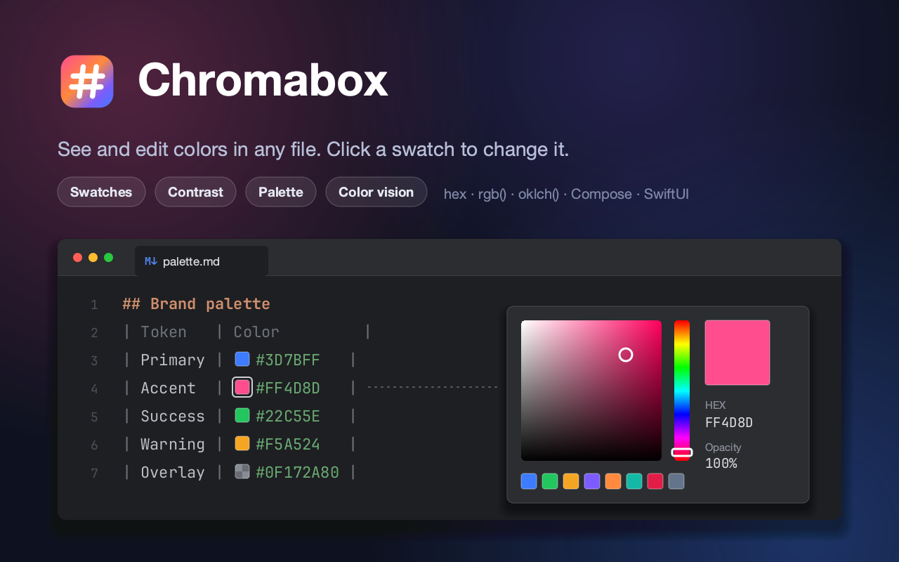
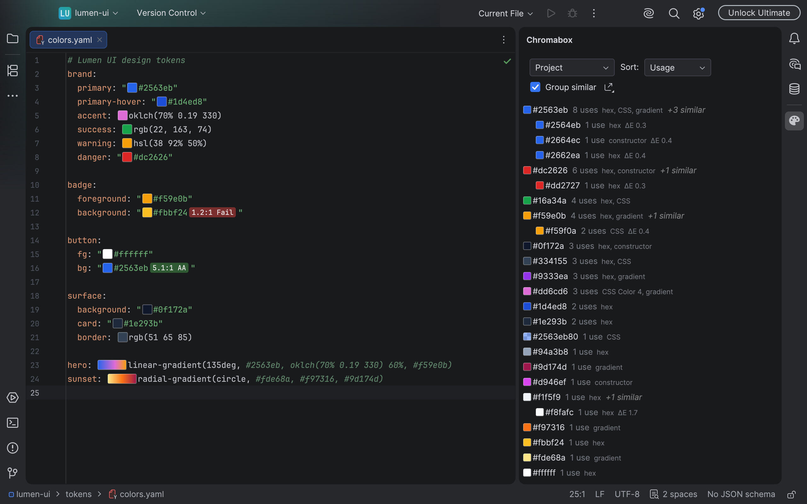
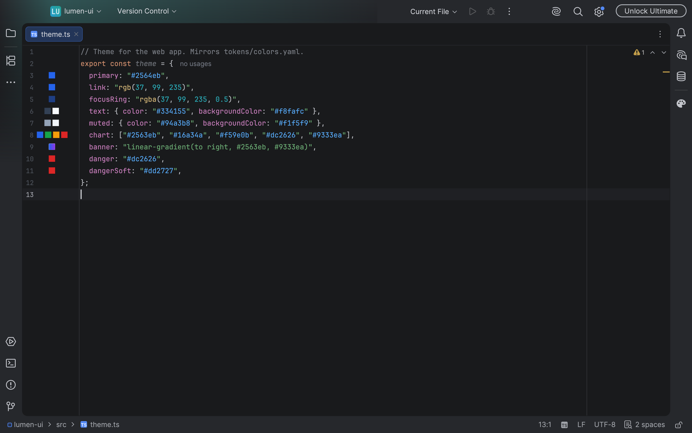
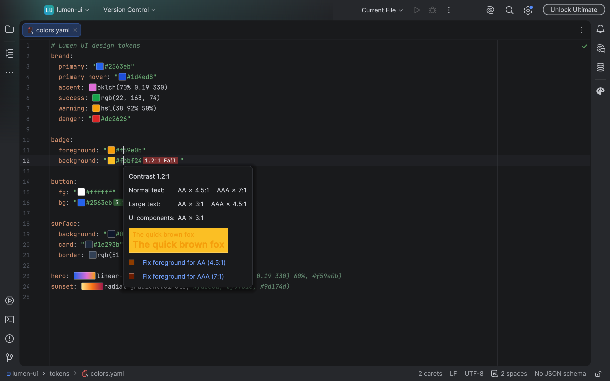
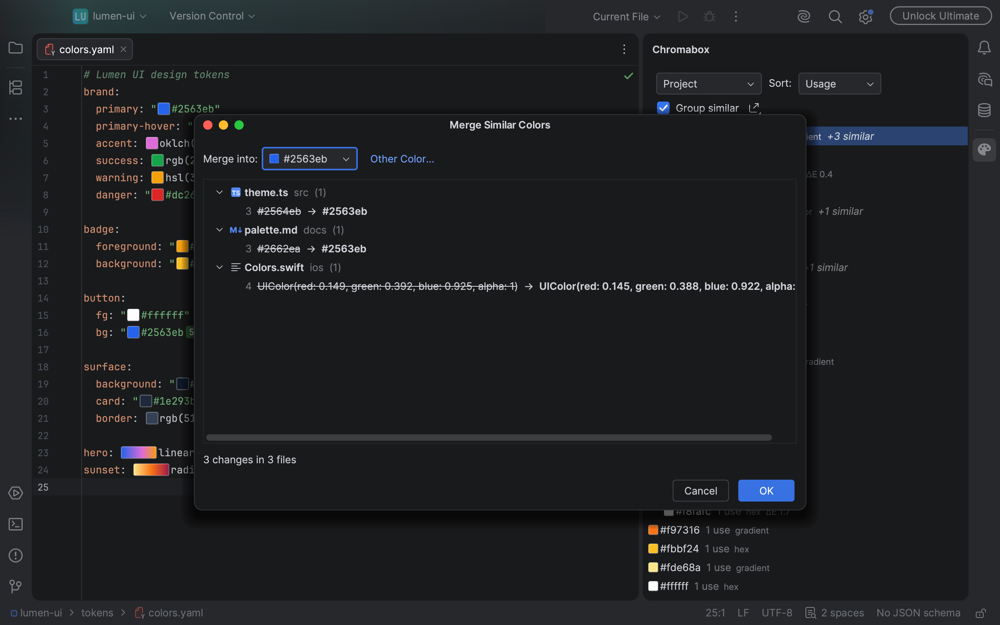
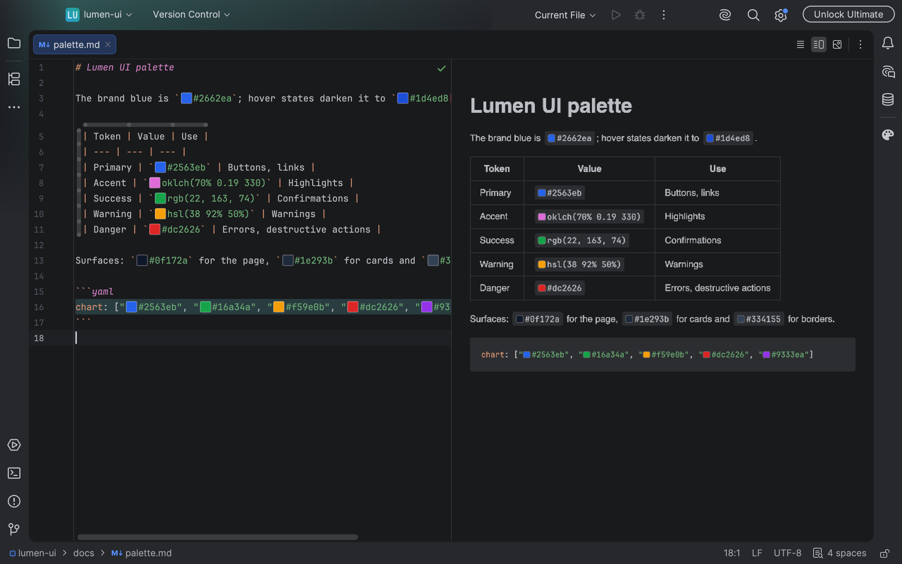
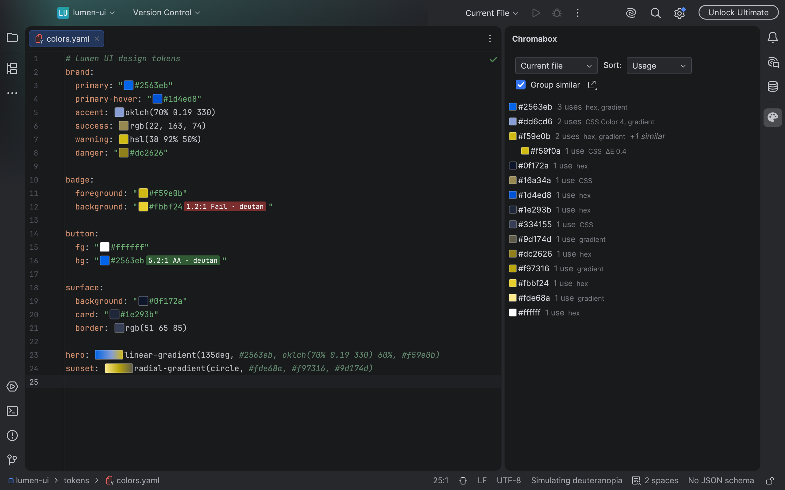
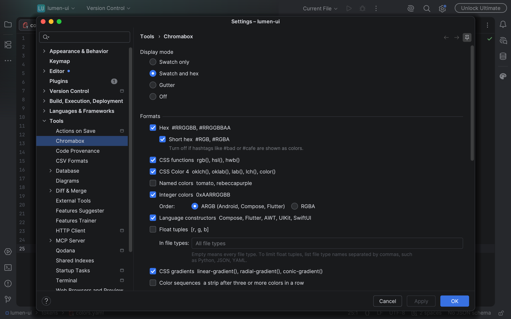

# Chromabox

Chromabox shows color swatches next to colors in any text file, such as Markdown, YAML, JSON, CSV or source code, in
IntelliJ IDEA and the other JetBrains IDEs. Click a swatch to pick a new color; it's written back in the notation it
was written in. It also checks the contrast of colors that belong together, lists every color in a project with the
ones that are nearly the same, shows swatches in the Markdown preview, and shows colors as people with a color vision
deficiency see them.

- [Installation](#installation)
- [Swatches](#swatches)
- [Display modes](#display-modes)
- [Contrast](#contrast)
- [The Chromabox tool window](#the-chromabox-tool-window)
- [Markdown preview](#markdown-preview)
- [Color vision](#color-vision)
- [Settings](#settings)
- [Building from source](#building-from-source)

## Installation

In the IDE, open _Settings | Plugins | Marketplace_, search for **Chromabox**, and install it.
Chromabox works in IntelliJ IDEA and the other IntelliJ-based IDEs, 2026.2 and later, and it doesn't use the network.

To install a build instead, use _Settings | Plugins | ⚙ | Install Plugin from Disk_ and choose the `.zip` file.

## Swatches

Every color Chromabox recognizes gets a swatch. Click it to open the color picker; the picked color is written back in
the same notation, and one undo reverts the whole pick.

| Format | Examples | Default |
|---|---|---|
| Hex | `#f00`, `#f008`, `#1E90FF`, `#1E90FF80` | On |
| CSS functions | `rgb(255, 0, 0)`, `rgba(255,0,0,.5)`, `rgb(255 0 0 / 50%)`, `hsl(120deg 50% 50%)`, `hwb()` | On |
| CSS Color 4 | `oklch(70% 0.1 200)`, `oklab()`, `lab()`, `lch()`, `color(display-p3 1 0 0)` | On |
| Integer colors | `0xFFAABBCC` (ARGB, or RGBA in settings) | On |
| Language constructors | `Color(0xFF112233)`, `Color.fromARGB(255, 1, 2, 3)`, `new Color(1, 2, 3)`, `UIColor(red: 0.1, green: 0.2, blue: 0.3, alpha: 1)` | On |
| Named colors | `tomato`, `rebeccapurple` | Off |
| Float tuples | `[0.1, 0.2, 0.3]`, `(1.0, 0.5, 0.0, 1.0)` | Off |
| CSS gradients | `linear-gradient(to right, #fff, rgb(0 0 0 / 50%))`, `radial-gradient()`, `conic-gradient()`, `repeating-` ones | On |
| Color sequences | `#264653, #2a9d8f, #e9c46a`, `red → orange → yellow` | Off |

Writing back keeps the function name, separators, units, number style and case. If the picked color has alpha and
the original doesn't, alpha is added in the same notation: `rgb(1, 2, 3)` becomes `rgba(1, 2, 3, 0.5)`. Colors in
CSS Color 4 spaces that are outside sRGB are drawn clamped, with a small "out of gamut" mark.

A CSS gradient gets one wide swatch showing the gradient, with its stops at their positions, instead of a swatch per
stop. Click it to choose a stop, then pick its color; only that stop is rewritten, in its own notation. Stops in
notations Chromabox doesn't edit, such as `transparent`, are drawn but can't be picked, and stops it can't read, such
as `var(--accent)`, are left out. Three or more colors in a row, separated by commas, spaces or arrows, can get a strip
of their colors after the last one; turn on _Color sequences_ in settings. Each color keeps its own swatch.

Colors the IDE already shows a swatch for, such as AWT colors in Java, don't get a second one. CSS-like files (CSS,
SCSS, Sass, Less, Stylus, PostCSS) are skipped by default, since the IDE has its own swatches there. Files larger than
2 million characters aren't scanned.

## Display modes

Switch modes in _View | Chromabox_, from the editor's context menu, or in settings. _Cycle Chromabox Display Mode_
goes through them and can be given a shortcut.

- **Swatch only**: the color text is folded away behind the swatch. Select the swatch, or use _Expand_, to edit the
  text.
- **Swatch and hex**: the swatch is shown before the color text. This is the default.
- **Gutter**: the text stays as it is; each line with colors gets a gutter icon, split into segments for up to four
  colors. Click it to pick a color, from a list if the line has several.
- **Off**: plain text.

## Contrast

Colors that belong together get a badge with their WCAG 2.2 contrast ratio and level, such as `4.6:1 AA`, after the
second color:

- a foreground and background key in one block: `fg`/`bg`, `foreground`/`background`, `color`/`background-color`,
  `text`/`surface`, or Material's `onPrimary`/`primary`;
- exactly two colors on one line.

A translucent foreground is blended over its background; a translucent background makes the ratio approximate
(`~4.6:1`). Badges can be shown always, only when failing AA, or never.

Hover or click a badge for details: results for normal text, large text and UI components, sample text, and, if
turned on in settings, the APCA lightness contrast (Lc). **Fix** changes the foreground's lightness, keeping its hue
and chroma, to the nearest color that reaches AA or AAA, and writes it in the same notation; one undo reverts it.

To check any two colors, put a caret on each (or select both) and use _Chromabox | Check Contrast_ in the editor's
context menu.

## The Chromabox tool window

The **Chromabox** tool window, on the right, lists the colors of the current file, the open files, the whole project
or any scope: each color once, with how often it's used and the formats it's written in, sorted by usage, hue or
lightness. Colors written differently, like `#FF0000`, `rgb(255, 0, 0)` and `red`, are one entry, and gradient stops
count too.

- **Find usages**, **copy as** hex, `rgb()`, `hsl()`, `oklch()`, Compose or SwiftUI, or **replace everywhere**:
  right-click a color. Replacing rewrites each occurrence in its own notation, and one undo reverts them all.
  Double-click a color to go to it.
- **Near-duplicates**: colors that look nearly the same are grouped under the most used one, with how far each is from
  it (CIEDE2000; under 1 is barely visible). Set how close they must be under _Palette_ in settings, 2 by default, or
  clear _Group similar_ to list every color on its own.
- **Merge Group Into…** picks one of the group's colors, or any other, and shows every change by file before writing
  it. Each occurrence keeps its notation, and one undo reverts the merge. Read-only files and text that changed after
  the preview are left as they are and reported.
- **Export** saves the listed colors, in the order they're listed, as JSON (hex, RGB, alpha, uses and formats), CSS
  custom properties (`--color-ff0000: #ff0000;` on `:root`), a GIMP palette (`.gpl`, which Inkscape, Krita and others
  read too; it has no alpha, so each color's name keeps its full hex), or a Markdown table.

The project and custom scopes use an index of the project's files, so they're quick, and colors show up as they're
found. For very large projects, clear _Index project colors_ under _Palette_ in settings to skip indexing; the current
and open files still work.

## Markdown preview

The Markdown preview shows a swatch before each color too, in prose, tables, inline code and code fences, in the Swatch
only and Swatch and hex modes. Colors are found the same way as in the editor, so the format settings apply. Preview
swatches can't be clicked; turn them off under _Markdown preview_ in settings.

## Color vision

To see colors as people with a color vision deficiency do, use _View | Chromabox | Simulate Color Vision_:
protanopia, deuteranopia, tritanopia (Machado et al. 2009, at full severity) or achromatopsia.

- Swatches, gradients, gutter icons and the tool window's colors are drawn as they'd look; the text doesn't change.
- Contrast badges show the ratio of the simulated colors, marked with the simulation (`3.2:1 AA Large · protan`). A
  fix in the contrast popup then reaches the level both with and without the simulation.
- The status bar shows the simulation while it's on; click it to switch.
- The simulation ends when the IDE closes, unless _Keep the simulation after restarting the IDE_ is on in settings.

## Settings

_Settings | Tools | Chromabox_ has the display mode, each format on its own, contrast badges, the palette, the Markdown
preview and the simulation. Changes apply to open editors right away.

- Short hex forms (`#RGB`, `#RGBA`) can be turned off if hashtags like `#bad` or `#cafe` show up as colors.
- Float tuples can be limited to chosen file types.
- The list of skipped file types is editable.

## Building from source

Chromabox is built with Gradle and the [IntelliJ Platform Gradle Plugin][docs:intellij-platform-gradle-plugin].

| Command | What it does |
|---|---|
| `./gradlew buildPlugin` | Builds `build/distributions/chromabox-<version>.zip`, to install from disk |
| `./gradlew runIde` | Starts an IDE with the plugin |
| `./gradlew check` | Runs the tests, and the scan benchmark in its own JVM: a 2-million-character file in under 150 ms |
| `./gradlew verifyPlugin` | Checks compatibility with the IDE versions JetBrains recommends |

The screenshots above are taken from the demo project in `docs/screenshots/demo`. Start
`./gradlew runIdeForScreenshots`, wait for the IDE window, then run `python3 docs/screenshots/capture/scenes.py`; the
IDE is driven through the Robot Server plugin, so leave it alone meanwhile. The banner is drawn by `docs/Banner.java`:
`java docs/Banner.java docs/chromabox-banner.png`.

[docs:intellij-platform-gradle-plugin]: https://plugins.jetbrains.com/docs/intellij/tools-intellij-platform-gradle-plugin.html
