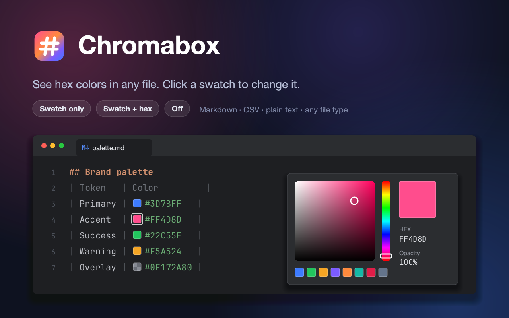

# Chromabox

[](https://twitter.com/JBPlatform)
[][jb:forum]



## Overview

Chromabox shows color swatches next to colors in any text file, such as Markdown, CSV, JSON, YAML or source code.
Click a swatch to open the color picker; the picked color is written back in the notation it was written in, and one
undo reverts the whole pick.

| Format | Examples | Default |
|---|---|---|
| Hex | `#f00`, `#f008`, `#1E90FF`, `#1E90FF80` | On |
| CSS functions | `rgb(255, 0, 0)`, `rgba(255,0,0,.5)`, `rgb(255 0 0 / 50%)`, `hsl(120deg 50% 50%)`, `hwb()` | On |
| CSS Color 4 | `oklch(70% 0.1 200)`, `oklab()`, `lab()`, `lch()`, `color(display-p3 1 0 0)` | On |
| Integer colors | `0xFFAABBCC` (ARGB, or RGBA in settings) | On |
| Language constructors | `Color(0xFF112233)`, `Color.fromARGB(255, 1, 2, 3)`, `new Color(1, 2, 3)`, `UIColor(red: 0.1, green: 0.2, blue: 0.3, alpha: 1)` | On |
| Named colors | `tomato`, `rebeccapurple` | Off |
| Float tuples | `[0.1, 0.2, 0.3]`, `(1.0, 0.5, 0.0, 1.0)` | Off |

Writing back keeps the function name, separators, units, number style and case. If the picked color has alpha and
the original doesn't, alpha is added in the same notation: `rgb(1, 2, 3)` becomes `rgba(1, 2, 3, 0.5)`. Colors in
CSS Color 4 spaces that are outside sRGB are drawn clamped, with a small "out of gamut" mark.

Display modes (_View | Chromabox_, the editor context menu, or _Settings | Tools | Chromabox_):

- **Swatch only**: the color text is folded away behind the swatch. Select the swatch, or use _Expand_, to edit the
  text.
- **Swatch and hex**: the swatch is shown before the color text.
- **Gutter**: the text stays as it is; each line with colors gets a gutter icon, split into segments for up to four
  colors. Click it to pick a color, from a list if the line has several.
- **Off**: plain text.

Colors that belong together get a contrast badge with their WCAG 2.2 ratio and level, such as `4.6:1 AA`, after the
second color: a foreground and background key in one block (`fg`/`bg`, `foreground`/`background`,
`color`/`background-color`, `text`/`surface`, Material's `onPrimary`/`primary`), or exactly two colors on one line.
A translucent foreground is blended over its background; a translucent background makes the ratio approximate
(`~4.6:1`). Badges can be shown always, only when failing AA, or never.

Each format can be turned on or off in _Settings | Tools | Chromabox | Formats_. Short hex forms (`#RGB`, `#RGBA`) can
be turned off if hashtags like `#bad` or `#cafe` show up as colors, and float tuples can be limited to chosen file
types. Colors the IDE already shows a swatch for, such as AWT colors in Java, don't get a second one. CSS-like file
types (CSS, SCSS, Sass, Less, Stylus, PostCSS) are skipped by default; the list is editable in settings. Files larger
than 2 million characters aren't scanned.

## Plugin structure

A generated project contains the following content structure:

```
.
├── .run/                   Predefined Run/Debug Configurations
├── gradle
│   ├── wrapper/            Gradle Wrapper
│   ├── libs.versions.toml  Version catalog
├── src                     Plugin sources
│   └── main
│       ├── kotlin/         Kotlin production sources
│       └── resources/      Plugin resources
│           ├── META-INF/   Plugin configuration file and logo
│           └── messages/   Message bundles
├── .gitignore              Git ignoring rules
├── build.gradle.kts        Gradle build configuration
├── gradle.properties       Gradle configuration properties
├── gradlew                 *nix Gradle Wrapper script
├── gradlew.bat             Windows Gradle Wrapper script
├── README.md               This file
└── settings.gradle.kts     Gradle project settings
```

In addition to the configuration files, the most crucial part is the `src` directory, which contains our implementation
and the manifest for our plugin – [plugin.xml][file:plugin.xml].

> [!NOTE]
> To use Java in your plugin, create the `/src/main/java` directory.

The plugin logo is placed in `src/main/resources/META-INF/pluginIcon.svg`.
See [Plugin Logo][docs:logo] for more information and logo requirements.

## Build script

The [build.gradle.kts][file:build.gradle.kts] is the core of the project definition.
It applies three Gradle plugins:

| Plugin                            | Description                                                                      |
|-----------------------------------|----------------------------------------------------------------------------------|
| `org.jetbrains.kotlin.jvm`        | Adds Kotlin support                                                              |
| `org.jetbrains.changelog`         | Simplifies patching the [CHANGELOG.md][file:CHANGELOG.md] file                   |
| `org.jetbrains.intellij.platform` | The [IntelliJ Platform Gradle Plugin][docs:intellij-platform-gradle-plugin-docs] |

The `intellijPlatform` dependencies block selects the IDE to compile against:

```kotlin
intellijIdea("2026.2.4")
```

See [Target Versions][docs:target-version] for more information.

The `intellijPlatform` dependencies block also contains a dependency on the platform testing framework:

```kotlin
testFramework(TestFrameworkType.Platform)
```

See [Testing][docs:testing] for more information

## Plugin configuration file

The plugin configuration file is a [plugin.xml][file:plugin.xml] file located in the `src/main/resources/META-INF`
directory.
It provides general information about the plugin, its dependencies, extensions, and listeners.

You can read more about this file in the [Plugin Configuration File][docs:plugin.xml] section of our documentation.

### Plugin ID and name

Generated plugin ID and name may require adjustment.

These values are generated based on _Group ID_ and _Artifact ID_ provided in the IDE Plugin wizard.
It is recommended to review `<id>` and `<name>` elements in the plugin.xml file, and adjust them if needed.

Please note that Gradle properties `rootProject.name` and `project.group` don't need to match the `<id>` and `<name>`
elements.
There is no IntelliJ Platform-related reason they should as they serve different functions.

## Predefined Run/Debug configurations

Within the default project structure, there is a `.run` directory provided containing predefined *Run/Debug
configurations* that expose corresponding Gradle tasks:

| Configuration name  | Description                                                                                                                                                                           |
|---------------------|---------------------------------------------------------------------------------------------------------------------------------------------------------------------------------------|
| Run IDE with Plugin | Runs [`:runIde`][docs:intellij-platform-gradle-plugin-runIde] IntelliJ Platform Gradle Plugin task. Use the *Debug* icon for plugin debugging.                                        |
| Run Tests           | Runs [`:check`][gradle:lifecycle-tasks] Gradle task.                                                                                                                                  |
| Run Verifications   | Runs [`:verifyPlugin`][docs:intellij-platform-gradle-plugin-verifyPlugin] IntelliJ Platform Gradle Plugin task to check the plugin compatibility against the specified IntelliJ IDEs. |

> [!NOTE]
> You can find the logs from the running task in the `idea.log` tab.

## Publishing the plugin

> [!TIP]
> Make sure to follow all guidelines listed in [Publishing a Plugin][docs:publishing] to follow all recommended and
required steps.

Releasing a plugin to [JetBrains Marketplace](https://plugins.jetbrains.com) is a straightforward operation that uses
the `publishPlugin` Gradle task provided by
the [intellij-platform-gradle-plugin][docs:intellij-platform-gradle-plugin-docs].

You can also upload the plugin to the [JetBrains Plugin Repository](https://plugins.jetbrains.com/plugin/upload)
manually via UI.

## Useful links

- [IntelliJ Platform SDK Plugin SDK][docs]
- [IntelliJ Platform Gradle Plugin Documentation][docs:intellij-platform-gradle-plugin-docs]
- [IntelliJ Platform Explorer][jb:ipe]
- [JetBrains Marketplace Quality Guidelines][jb:quality-guidelines]
- [IntelliJ Platform UI Guidelines][jb:ui-guidelines]
- [JetBrains Marketplace Paid Plugins][jb:paid-plugins]
- [IntelliJ SDK Code Samples][gh:code-samples]

[docs]: https://plugins.jetbrains.com/docs/intellij
[docs:plugin.xml]: https://plugins.jetbrains.com/docs/intellij/plugin-configuration-file.html?from=IJPluginReadmeFile
[docs:publishing]: https://plugins.jetbrains.com/docs/intellij/publishing-plugin.html?from=IJPluginReadmeFile
[docs:intellij-platform-gradle-plugin-docs]: https://plugins.jetbrains.com/docs/intellij/tools-intellij-platform-gradle-plugin.html?from=IJPluginReadmeFile
[docs:intellij-platform-gradle-plugin-runIde]: https://plugins.jetbrains.com/docs/intellij/tools-intellij-platform-gradle-plugin-tasks.html?from=IJPluginReadmeFile#runIde
[docs:intellij-platform-gradle-plugin-verifyPlugin]: https://plugins.jetbrains.com/docs/intellij/tools-intellij-platform-gradle-plugin-tasks.html?from=IJPluginReadmeFile#verifyPlugin
[docs:logo]: https://plugins.jetbrains.com/docs/intellij/plugin-icon-file.html?from=IJPluginReadmeFile
[docs:target-version]: https://plugins.jetbrains.com/docs/intellij/tools-intellij-platform-gradle-plugin-dependencies-extension.html?from=IJPluginReadmeFile#target-versions
[docs:testing]: https://plugins.jetbrains.com/docs/intellij/tools-intellij-platform-gradle-plugin-dependencies-extension.html?from=IJPluginReadmeFile#testing

[file:build.gradle.kts]: ./build.gradle.kts
[file:CHANGELOG.md]: ./CHANGELOG.md
[file:gradle.properties]: ./gradle.properties
[file:plugin.xml]: ./src/main/resources/META-INF/plugin.xml

[gh:code-samples]: https://github.com/JetBrains/intellij-sdk-code-samples

[gradle:lifecycle-tasks]: https://docs.gradle.org/current/userguide/java_plugin.html#lifecycle_tasks

[jb:github]: https://github.com/JetBrains/.github/blob/main/profile/README.md
[jb:forum]: https://platform.jetbrains.com/
[jb:quality-guidelines]: https://plugins.jetbrains.com/docs/marketplace/quality-guidelines.html
[jb:paid-plugins]: https://plugins.jetbrains.com/docs/marketplace/paid-plugins-marketplace.html
[jb:ipe]: https://jb.gg/ipe
[jb:ui-guidelines]: https://jetbrains.github.io/ui
